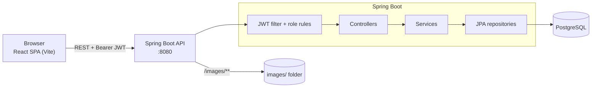

# E-Shop

A full-stack e-commerce app: a Spring Boot REST API with JWT authentication and a React storefront with cart, checkout, order history and an admin area.


## Table of contents

- [Features](#features)
- [Tech stack](#tech-stack)
- [Architecture](#architecture)
- [Prerequisites](#prerequisites)
- [Installation and setup](#installation-and-setup)
- [Environment variables](#environment-variables)
- [Running the app](#running-the-app)
- [API documentation](#api-documentation)
- [Testing](#testing)
- [Deployment notes](#deployment-notes)
- [Screenshots](#screenshots)
- [Contributing](#contributing)
- [License](#license)
- [Contact](#contact)

## Features

**Storefront**
- Browse products with search, category filter, price sorting and pagination (state lives in the URL, so links are shareable)
- Product detail page and quick-view dialog
- Register, sign in, sign out; the session survives a page reload and an expired token logs you out cleanly
- Cart saved to your account (add, change quantity, remove, totals), shown as a badge in the navbar
- Checkout with address book, order summary and a **mock (test) payment** or cash on delivery
- Order history, order detail and cancelling an order that is still `PLACED`
- Profile: change email and password, manage saved addresses
- Responsive layout, loading / empty / error states, form validation, toast messages, 404 page

**Admin** (users with `ROLE_ADMIN`)
- Create, edit and delete products, upload product images
- Manage categories
- View all orders and move them through `PROCESSING`, `SHIPPED`, `DELIVERED` or `CANCELLED`
- Grant or revoke user roles

**Backend**
- Role-based authorisation, ownership checks on carts, addresses and orders
- Bean validation with one consistent JSON error shape
- Stock re-checked under a row lock at checkout (no overselling); cancelling returns stock
- Swagger UI for the API, in-memory H2 profile for zero-setup development

## Tech stack

| Area | Technologies |
| --- | --- |
| Frontend | React 19, Vite, React Router 7, Redux Toolkit, Axios, Tailwind CSS 4, Material UI, Headless UI, react-hot-toast |
| Backend | Java 17, Spring Boot 3.2 (Web, Data JPA, Security, Validation), JJWT, ModelMapper, springdoc-openapi |
| Database | PostgreSQL (default), H2 in memory (`h2` profile and tests) |
| Tooling | Maven, npm, ESLint, JUnit 5 + MockMvc, Vitest + Testing Library, Docker Compose (database only) |

## Architecture



```text
.
├── backend/                       Spring Boot API
│   ├── src/main/java/com/ecommerce/project/
│   │   ├── config/                OpenAPI, static images, demo-data initializer
│   │   ├── controller/            REST endpoints
│   │   ├── service/               business logic (interfaces + *Impl)
│   │   ├── repositories/          Spring Data JPA
│   │   ├── model/                 JPA entities
│   │   ├── payload/               request/response DTOs
│   │   ├── security/              JWT filter, security rules, CORS
│   │   ├── exceptions/            error types + global handler
│   │   └── util/                  AuthUtil, ProductDtoMapper
│   ├── src/main/resources/        application.properties (+ h2 profile)
│   └── src/test/                  MockMvc API tests (H2)
├── frontend/
│   └── src/
│       ├── api/                   Axios client + interceptors
│       ├── store/                 Redux store, auth and cart slices
│       ├── pages/                 route pages (+ pages/admin)
│       ├── components/            UI, layout, catalog components
│       ├── hooks/  utils/  test/
├── docs/PLAN.md                   what was found and changed
├── docker-compose.yml             local PostgreSQL
└── package.json                   root convenience scripts
```

How requests flow: the SPA sends `Authorization: Bearer <jwt>`; `AuthTokenFilter` authenticates it, `WebSecurityConfig` applies the URL rules (`/api/public/**` open for GET, `/api/admin/**` admin only, everything else signed in), controllers validate DTOs, services enforce ownership and stock, and `MyGlobalExceptionHandler` turns failures into `{ "message": "...", "status": false, "errors": {...} }`.

## Prerequisites

| Tool | Version | Needed for |
| --- | --- | --- |
| Java JDK | 17 or newer | backend |
| Maven | 3.6.3 or newer | backend |
| Node.js + npm | 20.19 or newer (developed on Node 25) | frontend |
| PostgreSQL 14+ **or** Docker | any recent | database (not needed for the `h2` quick start) |

## Installation and setup

```bash
# 1. Clone
git clone <your-fork-or-repo-url> e-shop
cd e-shop

# 2. Install frontend dependencies
npm run install:all

# 3. Backend environment file (read automatically when the backend starts from /backend)
cp backend/.env.example backend/.env
```

Edit `backend/.env` and set a real `JWT_SECRET` (Base64, at least 32 bytes). Generate one with either:

```bash
openssl rand -base64 32
node -e "console.log(require('crypto').randomBytes(32).toString('base64'))"
```

On Windows PowerShell use `Copy-Item backend/.env.example backend/.env`.

**Pick a database:**

- **Quick start, no database:** use the `h2` profile (see [Running the app](#running-the-app)). Data lives in memory and demo data is created on every start. Only `JWT_SECRET` is required.
- **PostgreSQL with Docker:** set `DB_PASSWORD` in `backend/.env`, then
  ```bash
  npm run db:up
  ```
  This starts PostgreSQL 16 on port 5432 with a database named `sb_ecom`.
- **Your own PostgreSQL:** create a database called `sb_ecom` (or point `DB_URL` at another one) and set `DB_USERNAME` / `DB_PASSWORD`.

Hibernate creates and updates the tables on startup (`DDL_AUTO=update`). There are no migration scripts yet.

**Demo data (development only).** Set `APP_SEED_ENABLED=true` in `backend/.env` (it is always on in the `h2` profile) to create:

| User | Role(s) | Password |
| --- | --- | --- |
| `user1` | customer | value of `SEED_PASSWORD` (default `ChangeMe123!`) |
| `seller1` | seller | same |
| `admin` | customer, seller, admin | same |

plus 5 categories and 12 products. Never enable seeding on a public server, or at least change `SEED_PASSWORD`.

**Frontend environment (optional).** `frontend/.env` defaults to the local backend. To change it:

```bash
cp frontend/.env.example frontend/.env   # then edit VITE_BACK_END_URL
```

## Environment variables

### Backend (`backend/.env` or real environment variables)

| Name | Description | Example |
| --- | --- | --- |
| `JWT_SECRET` | **Required.** Base64 key, at least 32 bytes, used to sign tokens | `openssl rand -base64 32` |
| `DB_PASSWORD` | Required for PostgreSQL (not for the `h2` profile) | `change-me` |
| `DB_URL` | JDBC URL | `jdbc:postgresql://localhost:5432/sb_ecom` |
| `DB_USERNAME` | Database user | `postgres` |
| `DDL_AUTO` | Hibernate schema mode (`update`, `validate`, ...) | `update` |
| `JWT_EXPIRATION_MS` | Token (and cookie) lifetime | `86400000` (24 h) |
| `FRONTEND_URL` | Allowed browser origin(s), comma separated (CORS) | `http://localhost:5173` |
| `IMAGE_BASE_URL` | Public URL prefix of uploaded images | `http://localhost:8080/images/` |
| `IMAGE_DIR` | Folder uploaded images are stored in | `images/` |
| `COOKIE_SECURE` | Set `true` when the API is served over HTTPS | `false` |
| `APP_SEED_ENABLED` | Create demo users and products on startup | `false` |
| `SEED_PASSWORD` | Password for the demo users | `ChangeMe123!` |
| `SHOW_SQL` / `LOG_LEVEL` | Debugging aids | `false` / `INFO` |
| `SERVER_PORT` | HTTP port (Spring Boot standard) | `8080` |
| `SPRING_PROFILES_ACTIVE` | Set to `h2` for the in-memory database | `h2` |

### Frontend (`frontend/.env`, read at build time)

| Name | Description | Example |
| --- | --- | --- |
| `VITE_BACK_END_URL` | Backend origin, without `/api` | `http://localhost:8080` |

## Running the app

### Development

Open two terminals in the repository root.

```bash
# Terminal 1: backend on http://localhost:8080
npm run dev:backend:h2      # in-memory database + demo data (needs only JWT_SECRET)
# or, with PostgreSQL:
npm run dev:backend

# Terminal 2: frontend on http://localhost:5173
npm run dev:frontend
```

Then open <http://localhost:5173>. Swagger UI is at <http://localhost:8080/swagger-ui/index.html>.

Try it: register an account, add products to the cart, check out with the test card and open the order. To use the admin area sign in as `admin` (needs demo data).

### Production build

```bash
npm run build                                   # backend jar + frontend/dist
cd backend
java -jar target/sb-ecom-0.0.1-SNAPSHOT.jar     # uses PostgreSQL unless SPRING_PROFILES_ACTIVE=h2
```

`frontend/dist` is a static site. Serve it with any web server (Nginx, a static host, a CDN). `VITE_BACK_END_URL` is baked in at build time, so build with the URL of your deployed API. For a quick local look: `npm --prefix frontend run preview` (add `http://localhost:4173` to `FRONTEND_URL` so CORS allows it).

## API documentation

Interactive docs: **Swagger UI** at `/swagger-ui/index.html` and the OpenAPI JSON at `/v3/api-docs` (use *Authorize* with the `jwtToken` from sign-in). All routes are under `/api`. "Auth" is what the server enforces.

| Method | Path | Auth | Description |
| --- | --- | --- | --- |
| POST | `/auth/signup` | public | Register a customer (`username`, `email`, `password`) |
| POST | `/auth/signin` | public | Sign in; returns user info and `jwtToken`, sets an HttpOnly cookie |
| POST | `/auth/signout` | public | Clear the auth cookie |
| GET | `/auth/user` | user | Current user from the token |
| GET | `/users/me` | user | Profile |
| PUT | `/users/me` | user | Update email / change password |
| GET | `/public/products` | public | List products: `keyword`, `category`, `pageNumber`, `pageSize` (max 100), `sortBy` (`productId`, `productName`, `price`, `specialPrice`, `quantity`), `sortOrder` (`asc`/`desc`) |
| GET | `/public/products/{id}` | public | Product detail |
| GET | `/public/products/keyword/{keyword}` | public | Search by name |
| GET | `/public/categories` | public | List categories (paged) |
| GET | `/public/categories/{id}/products` | public | Products in a category |
| GET | `/carts/users/cart` | user | My cart |
| POST | `/carts/products/{productId}/quantity/{quantity}` | user | Add to cart (increases quantity if already there) |
| PUT | `/cart/products/{productId}/quantity/{add\|delete}` | user | Change quantity by +1 / -1 |
| DELETE | `/carts/{cartId}/product/{productId}` | user | Remove an item (own cart only) |
| GET | `/addresses`, `/users/addresses` | user | My addresses |
| POST | `/addresses` | user | Create address |
| GET / PUT / DELETE | `/addresses/{id}` | user | Read / update / delete one of my addresses |
| POST | `/order/users/payments/{MOCK_CARD\|COD}` | user | Place an order from my cart; body `{ "addressId": 1 }` |
| GET | `/orders` | user | My orders (paged) |
| GET | `/orders/{id}` | user (admin: any) | Order detail |
| POST | `/orders/{id}/cancel` | user | Cancel my order while `PLACED` |
| POST | `/admin/categories` | admin | Create category |
| PUT / DELETE | `/admin/categories/{id}` | admin | Rename / delete (only if empty) |
| POST | `/admin/categories/{categoryId}/product` | admin | Create product |
| PUT / DELETE | `/admin/products/{id}` | admin | Update / delete product |
| PATCH | `/admin/products/{id}/categories/{categoryId}` | admin | Move product to another category |
| PUT | `/admin/products/{id}/image` | admin | Upload image (multipart field `image`) |
| GET | `/admin/orders` | admin | All orders (paged) |
| PATCH | `/admin/orders/{id}/status` | admin | Set order status |
| GET | `/admin/users` | admin | All users (paged) |
| PUT | `/admin/users/{id}/roles` | admin | Replace a user's roles |
| GET | `/admin/carts` | admin | All carts |

Error responses always look like `{ "message": "...", "status": false }`; validation errors add `"errors": { "field": "message" }`. Status codes: `400` validation / business rule, `401` not signed in, `403` wrong role, `404` not found (also used when you ask for someone else's resource), `409` data conflict.

## Testing

```bash
npm test               # backend + frontend
npm run test:backend   # 22 MockMvc tests on in-memory H2, no database needed
npm run test:frontend  # 31 Vitest + Testing Library tests
npm run lint           # ESLint for the frontend
```

The backend tests use a separate `test` profile with its own throw-away JWT key and run against H2 (not PostgreSQL).

## Deployment notes

- Build the jar (`npm run build:backend`) and the static site (`npm run build:frontend`). Deploy them separately or put both behind one reverse proxy.
- Provide real secrets through environment variables: `JWT_SECRET`, `DB_URL`, `DB_USERNAME`, `DB_PASSWORD`. Leave `APP_SEED_ENABLED` off.
- Set `FRONTEND_URL` to the exact origin of the deployed frontend, `IMAGE_BASE_URL` to the public URL of `/images/`, and `COOKIE_SECURE=true` behind HTTPS.
- Uploaded images are written to `IMAGE_DIR` on local disk. Use a persistent volume (or move to object storage) on platforms with ephemeral disks.
- Signup can never create admins. Create the first admin by running once with `APP_SEED_ENABLED=true` and a strong `SEED_PASSWORD` (this creates the `admin` user), or by adding `ROLE_ADMIN` to a user in the `user_role` table. Then turn seeding off and manage roles from the admin area.
- Switch `DDL_AUTO` to `validate` once you introduce migrations (Flyway or Liquibase is recommended; none is included yet).
- The token is kept in `localStorage`, which is simple but reachable by scripts if the site has an XSS bug. Keep dependencies updated and consider moving to HttpOnly cookie-only auth with CSRF protection for a hardened deployment.

## Screenshots

_Add screenshots to `docs/screenshots/` and link them here._

| Storefront | Product detail | Cart and checkout | Admin |
| --- | --- | --- | --- |
| _todo_ | _todo_ | _todo_ | _todo_ |

## Contributing

Contributions are welcome. Please read [CONTRIBUTING.md](CONTRIBUTING.md) for setup, commit conventions and the checks to run before opening a pull request.

## License

Released under the [MIT License](LICENSE).

## Contact

Muhammed Anwaf, <muhd.anwaf@gmail.com>. Please open an issue for bugs and feature requests.
